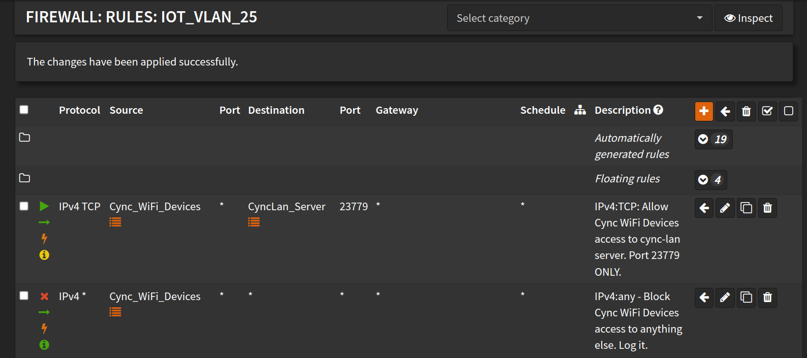

# Devices - never connect / unavailable / offline
If you followed the [DNS docs](./DNS.md) and the [Install docs](./install) and devices are still not connecting, 
you may need to check your network configuration (firewall, etc.). If the Cync devices are on a separate subnet, 
make sure that all Cync devices can talk to the local IP of the machine running `cync-lan`.

The devices open the connection, so the rule must allow traffic **from** the Cync devices' network **to**
cync-lan (TCP 23779). A rule in the other direction is not enough.

## Devices connect, but keep replacing each other
cync-lan tells connections apart by the device's IP address. If the log shows every device with the same IP (for
example `172.x.0.1`) and `Existing TCP session found, gracefully closing and replacing...` every few seconds,
something rewrites the devices' source address. Docker Desktop on Windows and macOS does this for published ports.
Run cync-lan on Linux with `network_mode: host` (or another setup where the devices' own IPs reach it).

## OPNSense Firewall Example

# I can't add new devices in the Cync phone App! It always fails at the last step "Adding to Home"
**Disable the DNS redirect so your phone app / new device(s) can connect to**
**the cloud, power cycle the new device(s) after disabling DNS redirect**

After device(s) are added to your Cync account:
- Export a new config
- Re-enable the [DNS redirection](./DNS.md)
- Restart the server
- Power cycle the new device(s)
- **Optional:** *you may need to power cycle other Cync devices if the DNS redirection was disabled for a while**
